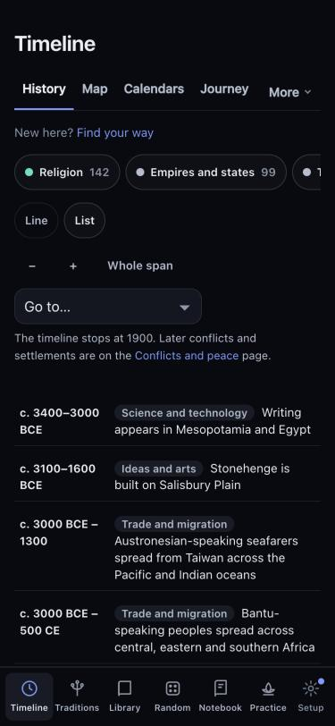
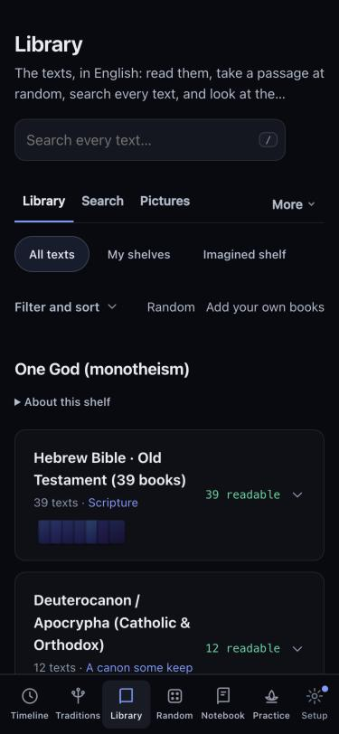
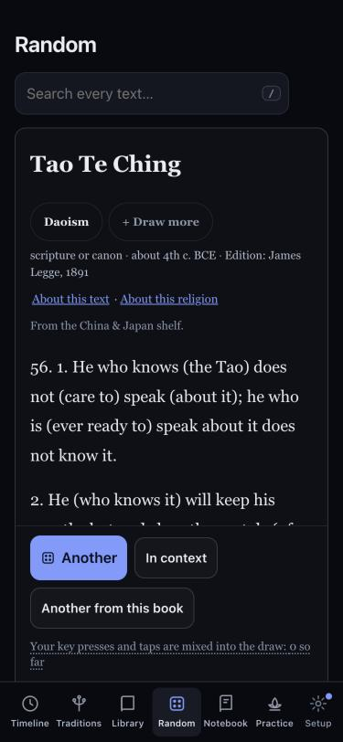
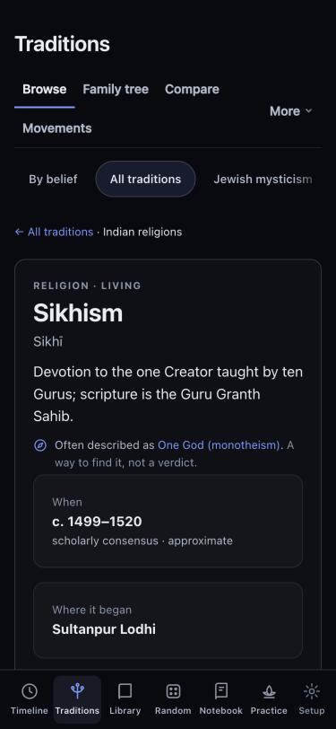

# The Lamplighter Project

A free library and research tool for studying human religion. It sets texts, dates, maps and sources side by side, and it does not tell you what to believe. It works with no internet once it is on your device, asks for no account, shows no advertising and tracks nothing.

> **Alpha.** Complete enough to use, not finished. Every History event, every cause on the Step by step page and every claim on the High-control groups page has had a second reading against the sources it cites; **none has been read by a specialist**. The Methods page inside the app says what was read, by whom, and how.


<table>
<tr>
<td></td>
<td></td>
<td></td>
<td></td>
</tr>
</table>

## What is in it

- **Library.** More than 1,500 English texts: scriptures, sources and the classics of the study of religion, with the printed page numbers of the edition where it has them. Read them as a scroll, as book pages or as PDF-style sheets; highlight, note, bookmark and cite.
- **Timeline and map.** A timeline of world history with religion woven in (496 events), a map of where 793 traditions began and spread, and calendars: any day in other calendars, and the sky on a day.
- **Traditions and compare.** A page for each tradition, a family tree, what is shared and what differs, and **Step by step**: the fewest recorded connections between two traditions, each with its causes and sources. Conflicts and settlements (86), set out so that each side is heard in its own words.
- **Random.** A passage drawn by chance (or from a text, a date, dice), with where it comes from, filtered by religion, period, shelf and kind of text.
- **Notebook.** Your own pages in Markdown, with clips that link back to the exact place in a text.
- **Practice.** Ways to worship, guided sits and sound.
- **Methods and standards.** Every statement says how well it is sourced (documented, reported or claimed, or disputed). The page lists what has been read, by whom, and every release.

## Principles

- **Free and yours.** MIT for the code, CC0 for what was written for the project, public domain or open licences for the texts. Nothing needs installing, and no one's permission is needed to keep a copy or pass it on.
- **Private.** No account, no cookies, no analytics, no outside requests. A test ([`lamplighter/tests/privacy.test.js`](lamplighter/tests/privacy.test.js)) reads the whole app on every build and fails on a network call, a tracker, or a font or script from another site. What you write is kept in your browser; export and erase are in Setup.
- **Neutral.** No tradition is ranked above another. Differences are kept in view beside similarities, claims say how well attested they are, and hard history is shown as something to understand, not to endorse. There is no recommendation engine.
- **Honest about what it knows.** The readable texts are public-domain or openly licensed English translations, so some sacred texts are missing because no free translation exists, and every entry without a text says so. Modern books under copyright are listed with where to find them, never copied.

## Try it

**https://lamplighter-project.pages.dev** opens the whole app, library included, on a phone or a laptop: nothing to install and no account. On an iPhone, Share, then Add to Home Screen, and it opens like an app. In the built-in browser of Facebook or Instagram it works but cannot be saved for offline use; open it in your own browser for that.

To run your own copy instead, or to build it from this repository, see below.

## Run your own copy

The app is one file, `Lamplighter.html`, with data folders beside it (`texts/`, `atlas/`, `bibles/`, `similar/`, `dictionary/`). The data is about 2 GB, so it is not in this repository: it comes in the release kits (on the Releases page, when the alpha is released) or is rebuilt by the tools in `lamplighter/tools/`. Unzip a kit and open `Lamplighter.html` in any browser. It works from a USB stick, a school or library computer, a phone's files, or any static web host.

## Build from source

You need Python 3 and Node.js. From the repository root:

```bash
python3 lamplighter/tools/build_atlas.py   # the map data (atlas/), from lamplighter/tools/atlas_src/
python3 lamplighter/build.py               # bundles lamplighter/src into Lamplighter.html
node lamplighter/tests/privacy.test.js     # one test; every test is a plain node script in lamplighter/tests/
```

That is enough to open the app and use the timeline, the map, the traditions and the tools. The texts, the Bibles, the dictionary and Find similar need their data folders (from a release kit, or rebuilt: `lamplighter/tools/build_texts.py` and the other builders named in [`lamplighter/README.md`](lamplighter/README.md), which fetch from public sources and are slow and polite). Nearly every test file runs without the data folders; the few that need them are listed in [`lamplighter/tests/ci-needs-data.txt`](lamplighter/tests/ci-needs-data.txt).

## What is in this repository

| Path | What it is |
|---|---|
| `lamplighter/src/` | The app's sources: `js/` (numbered in load order, no framework, no dependencies) and `css/app.css` |
| `lamplighter/build.py` | Bundles the sources into one self-contained `Lamplighter.html` |
| `lamplighter/tests/` | The tests: plain node scripts that print how many checks passed |
| `lamplighter/tools/` | The builders for the data (atlas, texts, Find similar, dictionary, downloads), the site and the release kits, and the data sources written for the project (`atlas_src/`) |
| `lamplighter/web/`, `icons/` | The app's icons, manifest and service worker |
| `lamplighter/README.md` | The developer's README: how the app is organised and every design decision, in order |
| `FACT_CHECK.md` | Every reading of the project's own claims against sources, claim by claim |
| `COLLECTION_PLAN.md`, `COVERAGE_ASSESSMENT.md`, `TEXT_AUDIT.md`, `LEFT_OUT_SORTED.md` | What the Library holds, what it lacks and why |
| `DISTRIBUTION.md` | How to host and pass on copies, with sizes and the rights notes |
| `ROADMAP.md` | What is planned |

## Texts and rights

The Library holds only texts in the public domain in the United States (published before 1931) or under an open licence, each with its source, edition and licence on its card. Books still in copyright are listed in [`POST1930_WANTED.md`](POST1930_WANTED.md) with where a person can find them, and are not hosted. If you hold rights in something here and want it removed, open an issue on this repository, and it will be taken out quickly. [`DISTRIBUTION.md`](DISTRIBUTION.md) explains the rights thinking in full.

## How it was made

The entries, the data and the code were written, and every reading in the Methods log was made, by AI assistants (Claude, by Anthropic) working for the maker, who decides what goes in. Each second reading was made by a different working session from the one that wrote the entry. A second reading is a second pass by another reader, not a specialist's review, and the project says so wherever it matters. Corrections from people who know the fields are the most valuable thing you can send.

## Contributing

Please read [`CONTRIBUTING.md`](CONTRIBUTING.md). The easiest help is a correction: a fact, a date, a translation, a broken page. Use the issue forms, or the "Tell the maker what to change" box in the app's Setup, which writes a plain note you can paste into an issue (it sends nothing itself).

## Licence

Code: MIT ([`LICENSE`](LICENSE)). Content written for the project: CC0 ([`LICENSE-CONTENT.txt`](LICENSE-CONTENT.txt)). The texts keep their own status: public domain, or the open licence named on each text's card.
